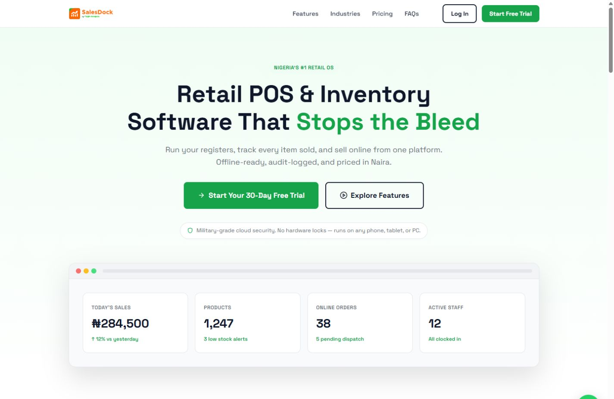
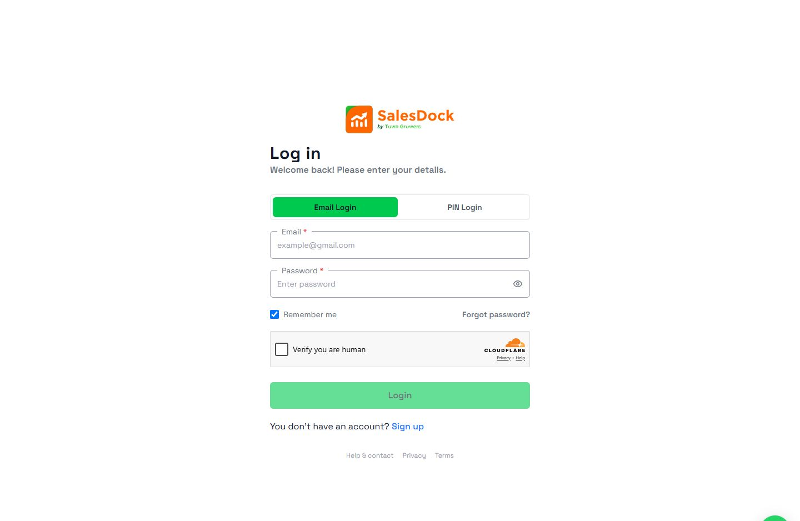

<div align="center">

<a href="https://salesdock.ng"></a>

# Every sale. Every item. One workspace.

**Point of sale, inventory, and online storefronts built for Nigerian retailers.**

Sell at the counter. Take orders online. Track stock across branches. Keep your team accountable.

[Visit SalesDock](https://salesdock.ng) · [Explore the product](#a-closer-look) · [Run locally](#run-locally)


</div>

---

SalesDock connects the work behind a retail business: the register, the stockroom, the online shop, and the back office. Merchants manage daily operations in a shared workspace, while platform administrators manage tenants, subscriptions, billing, and support.

The interface pairs SalesDock's orange identity with green actions, clear typography, and focused workspaces. The same product language carries from the public website through sign-in and into merchant operations.

## Built around the way retailers work

| Workspace | What it brings together |
| --- | --- |
|  **Point of sale** | Product selection, held sales, cash/card/transfer workflows, receipts, and payment status checks. |
|  **Inventory & branches** | Product variants, branch stock, adjustments, transfers, CSV imports, and restock monitoring. |
|  **Online storefront** | A merchant store link, product pages, cart, checkout, order tracking, and delivery integration. |
|  **Customers & suppliers** | Customer records, supplier management, purchase orders, and supplier messaging. |
|  **Business operations** | Expenses, financial reports, ledger, payroll, payslips, and tax filing workflows. |
|  **Team accountability** | Staff roles, granular permissions, PIN access, activity history, and audit logs. |
|  **Platform administration** | Tenant review, plan catalogue, subscriptions, revenue, webhooks, settings, and support tickets. |

Feature access depends on the merchant's plan and staff permissions. Payment, messaging, and delivery workflows require their corresponding provider configuration.

### Designed for local realities

- **Naira at the centre.** A product experience built around Nigerian retail businesses and local payment providers.
- **Sales through more than one channel.** Counter sales and online orders share the same application and inventory services.
- **An offline-capable register.** A service worker caches the POS shell and queues offline sales in IndexedDB for replay when connectivity returns. The register must first be opened online; payment verification and synchronisation require a connection.
- **Room to grow.** Tenant and branch records, plan-based access, and staff permissions support businesses beyond a single till.

## A closer look

### Homepage

<a href="public/readme/home.png"></a>

### Sign-in

<a href="public/readme/login.png"></a>

Actual public website captures, taken in October 2026 in the desktop layout. Select either image to open the original PNG. These show the homepage and sign-in experience.

**Use the pictures elsewhere:** download [the homepage capture](public/readme/home.png) or [the sign-in capture](public/readme/login.png). The files live in `public/readme/`, so committing them alongside this README keeps the GitHub image links intact. To copy a hosted image URL after pushing, open the image on GitHub and use its raw file link.

## Under the hood

SalesDock is a **Laravel monolith with server-rendered Blade views**, Eloquent models, and service classes for business workflows. Merchant tools, public storefronts, authentication, and platform administration live in one application.

| Layer | Implementation |
| --- | --- |
| Application | Laravel 13; this build runs on PHP 8.5 |
| Interface | Blade, Tailwind CSS 4, custom CSS, and browser JavaScript |
| Asset pipeline | Vite 8 and the Laravel Vite plugin |
| Persistence | Eloquent; PostgreSQL in the example environment |
| Offline POS | Service worker, Cache API, and IndexedDB |
| Payments | A shared `PaymentGateway` contract with Flutterwave and Paystack implementations |
| Background work | Laravel jobs, database queues, and scheduled commands |
| Quality tools | PHPUnit and Laravel Pint |

### How the code is organised

```text
app/
  Contracts/          Shared interfaces, including payment gateways
  Http/Controllers/  Authentication, merchant, storefront, and platform endpoints
  Http/Middleware/   Workspace access, roles, and session checks
  Jobs/              Background work such as delivery booking
  Models/            Tenants, branches, products, orders, billing, and more
  Services/          Sales, stock, payments, delivery, billing, and tax workflows
  Support/           Permissions, plan features, CSV helpers, and shared utilities
database/            Migrations, factories, and seeders
public/              Brand assets, service worker, and README screenshots
resources/views/     Blade layouts and role-specific screens
routes/              Web endpoints and scheduled tasks
tests/               Feature and unit coverage
```

Business workflows are expressed in services such as `SaleRecorder`, `BranchInventory`, `StoreCart`, and `BillingService`. `PaymentManager` selects the configured payment provider through a common contract. Workspace middleware applies role, permission, subscription, and plan checks before users reach protected screens.

The data model uses explicit tenant and branch associations, ULID identifiers on models such as `Tenant`, and existing camelCase database fields such as `tenantId` and `createdAt`.

## Run locally

### Requirements

- PHP 8.5 for parity with this build, Composer, and the PHP extensions required by the locked dependencies.
- Node.js 22.12+ and npm, compatible with the locked Vite 8 toolchain.
- PostgreSQL for the default `.env.example` configuration. Create an empty local `salesdock` database before migrating.

### Installation

```bash
git clone https://github.com/thatmanfrancis/Salesdock.git
cd Salesdock
composer install
```

Copy `.env.example` to `.env`, then set `APP_NAME=SalesDock`, your local `APP_URL`, and the `DB_*` values for your local database. The example environment uses PostgreSQL and database-backed sessions, cache, and queues.

```bash
php artisan key:generate --no-interaction
php artisan migrate --no-interaction
npm ci --ignore-scripts
npm run build
composer run dev
```

For a seeded local administrator, review `database/seeders/DatabaseSeeder.php` and run `php artisan db:seed --no-interaction` **only against a disposable local database**. It creates or updates an administrator with fixed development credentials and resets that account's password and authentication settings. Those credentials are defined in the seeder.

Registration, merchant approval, and plan selection are application workflows; a fresh database is not a populated merchant demonstration.

### Connected services

| Capability | Integration |
| --- | --- |
| Payments | Flutterwave or Paystack |
| Delivery | Fez Delivery, with merchant-owned delivery accounts |
| Transactional email | ZeptoMail |
| WhatsApp messaging | Zoho SalesIQ |
| Bot checks | Cloudflare Turnstile |
| Support chat | Tawk |
| Analytics | Google Analytics 4 |

Use `.env.example` as the configuration reference. Where supported, platform administration settings take precedence over environment bootstrap values. Provider-dependent flows need valid credentials; use sandbox accounts for local development.

Queue-backed features need a running worker. Scheduled features include subscription lifecycle tasks, tax filing generation, delivery updates, and POS payment reconciliation. Run these in separate terminals when exercising those workflows locally:

```bash
php artisan queue:work --no-interaction
php artisan schedule:work --no-interaction
```

## Development checks

```bash
# Run the test suite
php artisan test --compact

# Build frontend assets
npm run build

# Format changed PHP files
vendor/bin/pint --dirty --format agent
```

Tests use an in-memory SQLite database through `phpunit.xml`; enable the corresponding PHP SQLite extension before running them. Existing coverage includes POS payments, payment configuration, catalogue imports, profile PINs, and storefront cart behaviour.

---

<div align="center">

**Built by Town Growers. Built around the business behind every sale.**

[Explore SalesDock](https://salesdock.ng)

</div>
