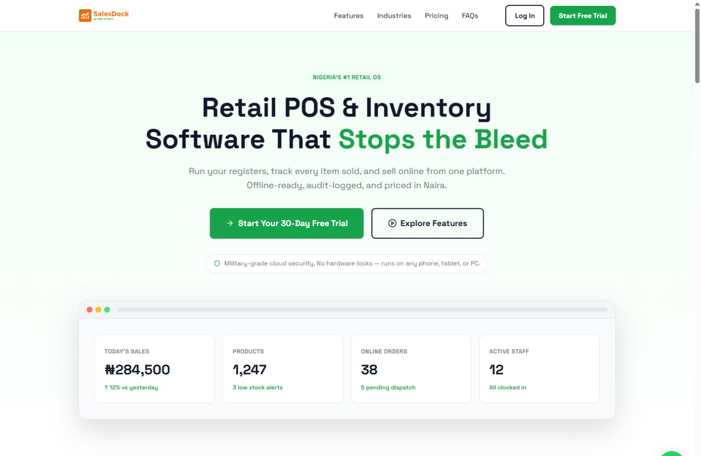
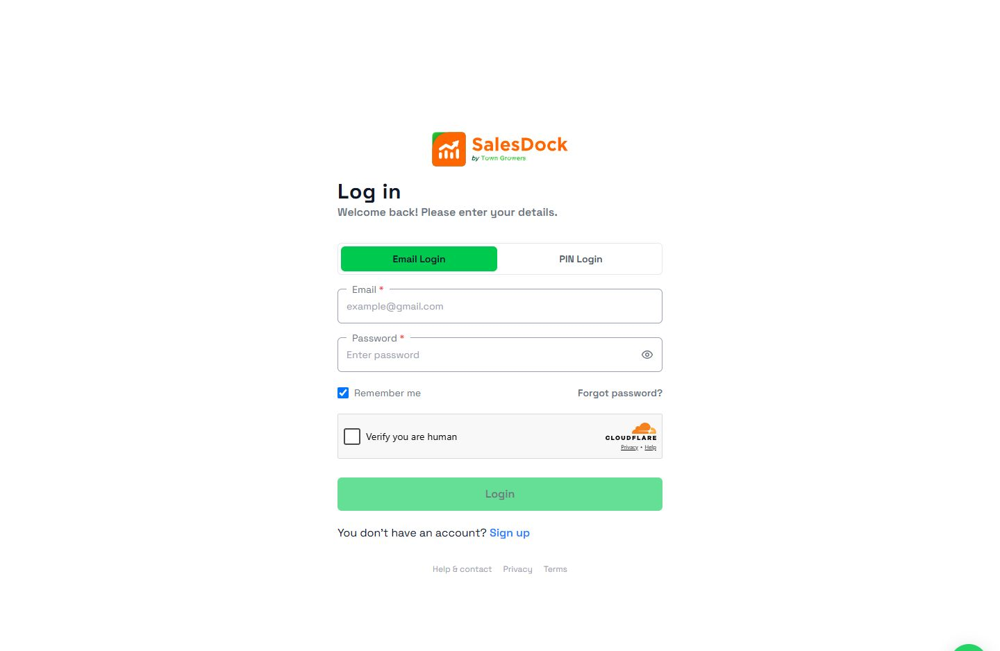

<div align="center">

<a href="https://salesdock.ng"></a>

# Every sale. Every item. One workspace.

**Point of sale, inventory and online storefronts for Nigerian retailers.**

[Visit SalesDock](https://salesdock.ng) · [Engineering decisions](#engineering-decisions-and-code) · [Run locally](#run-locally)

</div>



## Project context and my role

SalesDock is a **Town Growers** product bringing the register, stockroom, online shop and back office into one application.

**My role: Full Stack Engineer (contract).** My work focused on connecting point-of-sale checkout, online storefronts and shared inventory, with traceable sales operations and staff access controls. The case study below explains that contribution; the wider product overview describes the current repository rather than claiming sole authorship of every module.

## The problem and the work

### Situation — one business, several versions of the sale

A retailer can sell the same product at the counter and through an online shop. Those channels need to agree on stock, payment state and the order itself. Across branches and staff accounts, the problem becomes more than displaying a product catalogue: the business needs to know what was sold, where it came from, who processed it and whether payment was confirmed.

Connectivity adds another constraint. A register should preserve work during a connection failure, but a locally queued sale cannot be treated as a verified online payment or a confirmed update to the server's inventory.

### Task — connect checkout to the operations behind it

The goal was to connect in-store and online selling through shared application services, while preserving the context needed for inventory, payments and accountability.

The workflows needed to handle branch stock, pending payments, repeated checkout requests, held sales and different staff permissions. A sale should be represented consistently across the order, stock movements, transaction records and reporting inputs.

### Action — connect the customer flow to shared business logic

My contribution centered on the end-to-end retail workflow:

- Connected checkout and order handling with the product catalogue and inventory operations.
- Connected online storefront orders with the same retail data and sale-recording logic used by the application.
- Worked on keeping sales operations traceable through order, staff, branch and payment information.
- Worked across customer-facing screens and operational workflows rather than treating the storefront as a separate stock system.

The current implementation provides concrete examples of those concerns: `SaleRecorder` coordinates sales and completion, `BranchInventory` handles stock operations, `StoreCart` keeps merchant-specific carts, and `PosPayments` coordinates provider checkout and reconciliation. The sections below link directly to those components and relevant tests.

### Result — a connected retail workflow

The application brings point of sale, online ordering and branch inventory into a shared system. It represents pending and completed sales separately, associates transactions with orders, and records the branch and staff context needed to investigate activity.

The repository also contains regression tests for duplicate checkout, payment confirmation, branch reservations, cross-tenant access and staff privilege boundaries. These are inspectable engineering artifacts, rather than an unsupported claim that operational errors have been eliminated.

No revenue uplift, merchant count, reduction in stock discrepancies or checkout-speed improvement is claimed here without supporting measurement.

## Engineering decisions and code

### Record related sale changes in a transaction

`SaleRecorder` coordinates order creation, order items, stock changes and transaction records inside a database transaction. It uses row locks around relevant records and checks a tenant-scoped `checkoutRequestId` before recording another sale. For an existing matching request, the service can return the previously created order.

Pending-order completion is a separate operation: the service returns an already-completed order, rejects invalid completion states and checks whether provider verification is required. This makes retries and payment state part of the sale workflow rather than only a frontend concern.

[SaleRecorder](app/Services/SaleRecorder.php) · [POS payment regression tests](tests/Feature/PosPaymentTest.php)

### Model branch availability and reservations explicitly

`BranchInventory` handles stock quantities, additions, deductions and transfers. Its availability calculation accounts for reservations associated with pending orders at a branch. Storefront carts are scoped by tenant, and checkout line data is loaded from the merchant's products.

This distinguishes physical stock from stock currently available to sell and keeps merchant-specific shopping sessions separate.

[BranchInventory](app/Services/BranchInventory.php) · [StoreCart](app/Services/StoreCart.php) · [Cart tests](tests/Unit/StoreCartTest.php)

### Support payment providers through one contract

`PaymentManager` selects a Flutterwave or Paystack implementation through the shared `PaymentGateway` interface. `PosPayments` handles checkout initialization, stored attempt metadata and reference-based reconciliation.

Reconciliation queries the provider and passes the result through the settlement workflow. This gives the application a recovery path when a payment notification is missed, while preserving the distinction between initiating checkout and confirming payment.

[Payment contract](app/Contracts/PaymentGateway.php) · [Provider selection](app/Services/PaymentManager.php) · [POS payments](app/Services/PosPayments.php)

### Preserve staff and merchant boundaries

The workspace layer derives navigation and access behavior from the user's role, permissions, subscription and plan features. The repository includes feature tests checking that delegated staff cannot modify an owner's account, escalate their own role, grant permissions outside their role or cross shop boundaries.

These test cases make the intended privilege boundaries explicit and provide a starting point for reviewing changes to staff administration.

[Workspace middleware](app/Http/Middleware/ShareWorkspace.php) · [Permission definitions](app/Support/Permissions.php) · [Staff account protection tests](tests/Feature/StaffAccountProtectionTest.php)

### Queue offline work without claiming offline verification

The service worker caches the POS shell and stores offline sale submissions in IndexedDB for later synchronization. The register must first be opened online to populate its cache.

An offline queue preserves a submission; it does not confirm payment or guarantee current shared stock. Synchronization and provider verification still depend on connectivity and the server accepting the operation.

[Service worker](public/sw.js)

## The wider product

- **Point of sale:** product selection, held sales, receipts, supported payment methods and payment-status checks.
- **Inventory and branches:** product variants, stock adjustments, transfers, imports and restock monitoring.
- **Online storefronts:** merchant store links, product pages, carts, checkout and order tracking.
- **Customers and suppliers:** customer records, purchase orders and supplier communication.
- **Business operations:** expense, ledger, reporting, payroll and tax-related workflows.
- **Team accountability:** staff roles, granular permissions, PIN access, activity history and audit records.
- **Platform administration:** tenant review, plans, subscriptions, billing, settings and support.

Availability depends on the merchant's plan, staff permissions and configured providers.

## Technology


- **Application:** Laravel 13, PHP and Eloquent, organized as a monolith.
- **Interface:** server-rendered Blade views, Tailwind CSS 4 and browser JavaScript.
- **Assets:** Vite 8 and the Laravel Vite plugin.
- **Database:** PostgreSQL in the example environment.
- **Background work:** Laravel jobs, database queues and scheduled commands.
- **Offline support:** service worker, Cache API and IndexedDB.
- **Payments:** Flutterwave and Paystack implementations behind a common interface.
- **Development tools:** PHPUnit and Laravel Pint.

The monolith keeps merchant operations, storefronts and platform administration in one application. Shared service classes express the business workflows instead of duplicating them across channels.

## Screenshots

<details>
<summary>Sign-in experience</summary>



</details>

## Run locally

### Requirements

- PHP **8.5** to match the project's documented development environment, Composer and the extensions required by the locked dependencies.
- Node.js and npm compatible with the locked Vite 8 toolchain.
- PostgreSQL with an empty local `salesdock` database for the example configuration.
- The PHP SQLite extension for the configured test database.

### Install and configure

```bash
git clone https://github.com/thatmanfrancis/Salesdock.git
cd Salesdock
composer install
cp .env.example .env
```

Set `APP_NAME=SalesDock`, the local `APP_URL` and the `DB_*` values. The example configuration uses PostgreSQL and database-backed sessions, cache and queues.

```bash
php artisan key:generate --no-interaction
php artisan migrate --no-interaction
npm ci --ignore-scripts
npm run build
composer run dev
```

Use the local address reported by the development command and align `APP_URL` with it.

### Development accounts

Review [DatabaseSeeder](database/seeders/DatabaseSeeder.php) before seeding. It creates or updates a development administrator with fixed credentials and resets that account's password and authentication settings. Run it only against a disposable local database:

```bash
php artisan db:seed --no-interaction
```

A fresh database is not a populated merchant demo. Registration, merchant approval and plan selection remain application workflows.

### Connected services and background work

The repository documents integrations for Flutterwave/Paystack payments, Fez Delivery, ZeptoMail, Zoho SalesIQ messaging, Turnstile, support chat and analytics. Use `.env.example` and the relevant platform settings as configuration references. Provider-dependent flows require working credentials; use sandbox accounts when testing payments.

When exercising background or scheduled workflows, run the following in separate terminals if they are not already started by the development command:

```bash
php artisan queue:work --no-interaction
php artisan schedule:work --no-interaction
```

## Tests and development checks

Run the focused suites for the contribution areas discussed above:

```bash
php artisan test --compact tests/Feature/PosPaymentTest.php
php artisan test --compact tests/Feature/StaffAccountProtectionTest.php
php artisan test --compact tests/Unit/StoreCartTest.php
```

For the full suite and frontend asset build:

```bash
php artisan test --compact
npm run build
```

The test configuration uses in-memory SQLite, array-backed mail/session/cache and a synchronous queue. Existing cases cover payment confirmation, duplicate submissions, missed-webhook reconciliation, branch reservations and tenant/staff access boundaries, alongside other application tests.

These cases describe the repository's regression checks, not a newly executed test report. SQLite tests also do not establish PostgreSQL locking behavior under concurrent production traffic; verify that separately when evaluating transaction throughput or race conditions.

For changed PHP files, the repository's formatting command is:

```bash
vendor/bin/pint --dirty --format agent
```

## Further work

- Exercise payment retries, offline synchronization and stock reservations under PostgreSQL concurrency.
- Measure checkout completion, inventory reconciliation exceptions and payment-recovery behavior before publishing improvement figures.
- Keep provider setup, role permissions and operational runbooks aligned with changes to the application.

---

**Product: Town Growers. Full-stack engineering contribution: [Francis Uzoigwe](https://github.com/thatmanfrancis).**

[Explore SalesDock](https://salesdock.ng)
